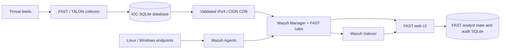

# F.A.S.T. — Fully Automated SIEM & Threat Intelligence Platform

[](https://github.com/eppzx2/fast/actions/workflows/ci.yml)


FAST's main goal is to bring up a complete cyber-monitoring/SOC environment with one command in about five minutes. On a prepared Linux host with Docker Engine and Compose, `./bin/fast up` starts Wazuh SIEM, threat-intelligence collection, FAST detections, and the analyst UI together. Actual time depends on host and network speed, especially during first-time image pulls.

> **One command. About five minutes to a working SOC environment.** On a prepared Linux host with Docker Engine and the Docker Compose plugin, clone the `test` branch and run `./bin/fast up`. First-time image downloads and host/network speed affect the actual duration.

## At a glance

- **Threat intelligence:** Feodo Tracker, Blocklist.de, OpenPhish, Spamhaus DROP, and optional MalwareBazaar hash intelligence.
- **SIEM:** pinned Wazuh 4.9.0 single-node stack with FAST rules and a validated IOC CDB list.
- **Security operations:** live Wazuh incidents with analyst-owned status, assignee, and notes.
- **Validation:** three evidence-based Linux detections for SSH brute force, port scanning, and LOLBin masquerading.
- **Operations:** one CLI for deployment, status, restart, shutdown, and safe IOC refresh.

## Architecture



Wazuh remains authoritative for agent inventory and alert telemetry. FAST keeps collected IOCs and analyst workflow metadata in separate SQLite databases. FAST does not modify Wazuh alert documents.

## Quick start

```bash
git clone --branch test https://github.com/eppzx2/fast.git
cd fast
./bin/fast up
./bin/fast status
```

The first deployment provisions the Wazuh SIEM stack, FAST web UI, and IOC collection workflow. A consistent progress indicator is shown during image builds; verbose build output is kept in a temporary log and shown if the build fails.

### Lifecycle commands

```bash
./bin/fast up                 # deploy/start FAST and collect live feeds
./bin/fast demo               # deploy with bundled IOC fixture data
./bin/fast status             # check containers, Manager and Filebeat -> Indexer
./bin/fast restart            # restart while preserving persistent data
./bin/fast down               # stop while preserving named Wazuh data volumes
./bin/fast up --reset-certs   # regenerate Wazuh TLS certificates, preserve data
```

For host requirements, configuration, agents, and recovery procedures, see the [Deployment Guide](docs/DEPLOYMENT_GUIDE.md).

## Threat feeds and IOC handling

| Source | Indicators | Access |
|---|---|---|
| Feodo Tracker | Botnet C2 IPv4 addresses | Public |
| Blocklist.de | Reported attacking IP addresses | Public |
| OpenPhish Community | Phishing URLs | Public |
| Spamhaus DROP | Malicious IPv4/CIDR ranges | Public |
| MalwareBazaar | Malware MD5, SHA-1, and SHA-256 hashes | Optional; free Auth-Key |

Configure `ABUSECH_AUTH_KEY` in the git-ignored `.env` file to enable MalwareBazaar. Without it, the optional feed is skipped while other providers continue. FAST fetches hash metadata and does not download malware samples.

The Wazuh CDB export contains validated IPv4 and IPv4-CIDR indicators only. URL and hash indicators remain searchable in FAST’s database and UI; they are not written to `sample_output/ioc-ips`.

### Collector CLI

`./bin/fast-cli` prepares the virtual environment and installs project requirements on first use; manual activation is not needed.

```bash
./bin/fast-cli --help
./bin/fast-cli --init-db
./bin/fast-cli --fetch
./bin/fast-cli --count
./bin/fast-cli --show
./bin/fast-cli --export csv
./bin/fast-cli --export json
./bin/fast-cli --export both
./bin/fast-cli --export wazuh
```

See the [IOC Collector User Guide](docs/user_guide.md) and [Feed Mapping](docs/feed_map.md) for behavior and field details.

## Detections and validation

| Rule | Detection | Threshold |
|---|---|---|
| `100200` | SSH brute force | 5 failures from one source IP within 60 seconds |
| `100211` | Port scan | 8 or more probes from one source IP within 60 seconds |
| `100221` | LOLBin / masquerading | `httpd` process from a non-standard path with wget-style arguments |

These are the three primary FAST incident detections. Supporting Wazuh staging rules are documented in the [Detection Runbook](docs/runbook.md). Validation status reflects real Wazuh alerts; the UI does not launch simulations.

## Web UI

The left navigation is ordered as **Overview → IOC Database → Incidents → MITRE ATT&CK → Architecture**. Architecture brings together operational areas such as the asset catalog, detection validation, and system health.

In **Incidents**, each alert expands inline. FAST displays fields present in the event, omitting unavailable values. Analyst status, assignee, and notes are stored separately from Wazuh. After a successful save, the incident returns to its compact row.

Default local address: `http://127.0.0.1:5000`.

## Optional Tailscale access

```bash
./bin/fast-share on
./bin/fast-share status
./bin/fast-share off
```

The helper exposes the FAST UI through Tailscale Funnel on HTTPS 443 and serves Wazuh Dashboard privately to tailnet devices on HTTPS 8443. FAST authentication is disabled by default for local/demo compatibility. Enable it before sharing the UI beyond a controlled demo.

## Refresh IOCs safely

```bash
./refresh_iocs.sh
```

The refresh validates collection/export, Wazuh rules, Manager recovery, and the Filebeat-to-Indexer alert path before reporting success.

## Agent installation

Linux:

```bash
sudo ./linux/install-wazuh-agent.sh --ip <MANAGER_IP>
```

Windows (elevated PowerShell):

```powershell
.\windows\install-wazuh-agent.ps1 -ManagerIP "<MANAGER_IP>"
```

## Tests and CI

GitHub Actions runs on pushes to `main`, `feature/fast-ui`, and `test`, and on pull requests. It checks Python compilation, browser JavaScript and shell syntax, and runs deterministic offline tests. Live acceptance tests require a deployed Manager and Linux target:

```bash
export TARGET_HOST=<TARGET_IP>
export TARGET_SSH_USER=<TARGET_USER>
python -m pytest tests/acceptance -v
```

## Documentation

| Guide | What it covers |
|---|---|
| [Documentation index](docs/README.md) | Guide map and implementation sources of truth |
| [Deployment](docs/DEPLOYMENT_GUIDE.md) | Host setup, configuration, agents, operations |
| [IOC Collector](docs/user_guide.md) | CLI, feeds, exports, database behavior |
| [Feed Mapping](docs/feed_map.md) | Provider fields, normalization, IOC types |
| [Platform UI](docs/PLATFORM_UI.md) | Tabs, data sources, incident behavior |
| [Security Operations](docs/SECURITY_OPERATIONS.md) | RBAC, incidents, assets, audit, APIs |
| [UI / Tailscale Deployment](docs/UI_DEPLOYMENT.md) | Local UI and private/public sharing boundary |
| [Attack Simulation](docs/SIMULATION_GUIDE.md) | Safe lab validation procedures |
| [Detection Runbook](docs/runbook.md) | Detection logic, investigation, response |
| [MITRE ATT&CK Mapping](docs/MITRE_MAPPING.md) | Mapping scope and live evidence semantics |

## Security notes

FAST is configured for lab/demo use, not direct production Internet exposure. Before a real deployment:

- change default Wazuh credentials and configure secrets in `.env`;
- restrict Wazuh management ports with a firewall or VPN;
- enable FAST authentication with a strong session secret and password;
- use secure cookies over HTTPS;
- keep `.env` out of git and rotate any exposed credentials;
- replace demo TLS settings/certificates with an appropriately verified setup;
- never expose the Docker socket or privileged deployment controls to the web container.

The default web port binds to localhost. Authentication is off until explicitly enabled.

**Documentation reviewed:** 2026-10-29
